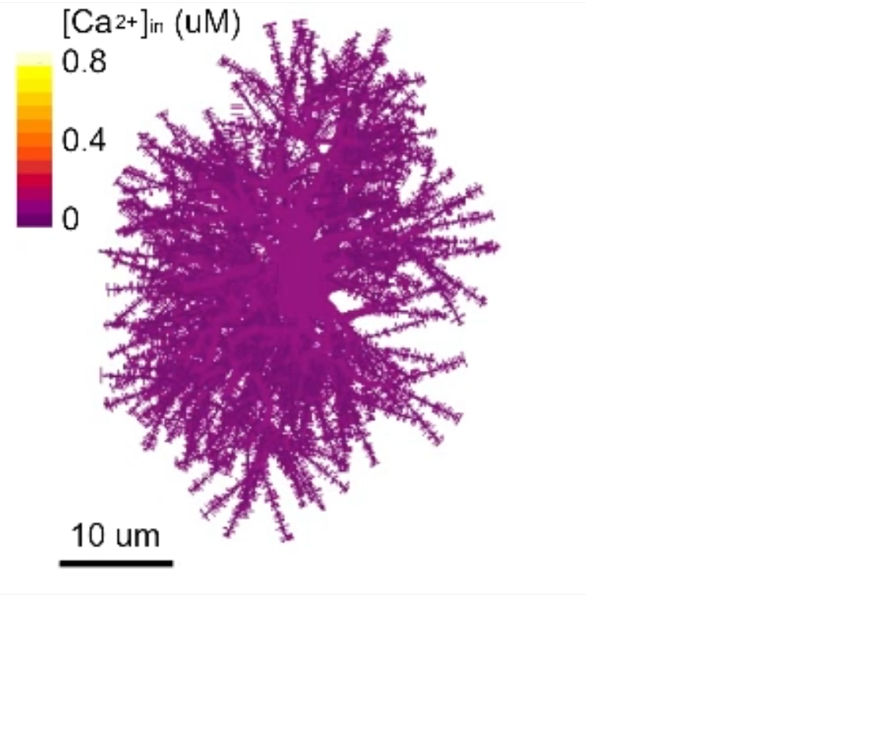
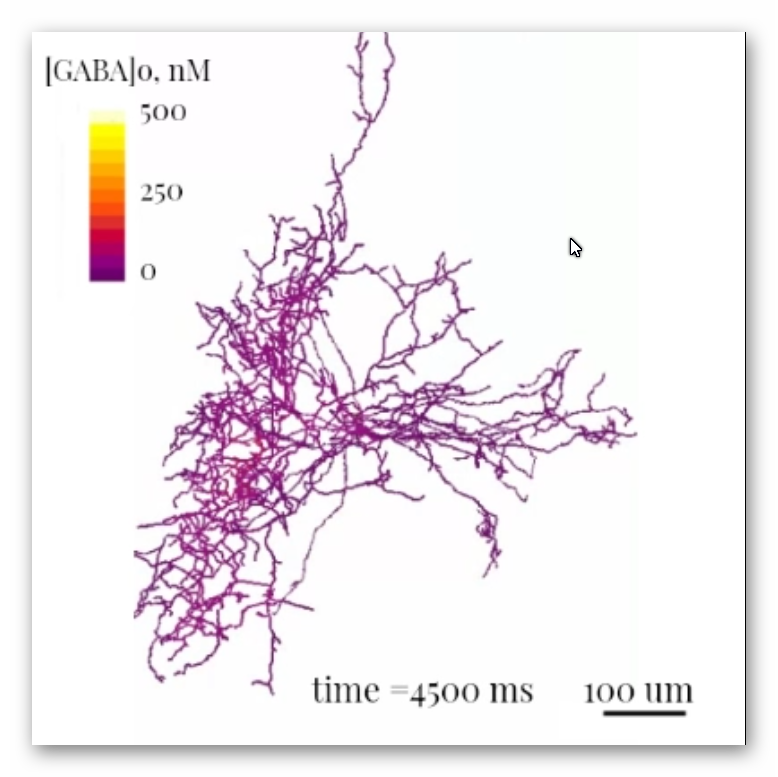
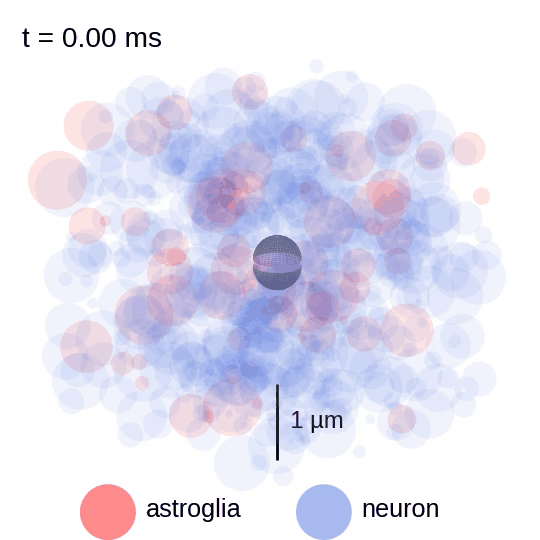
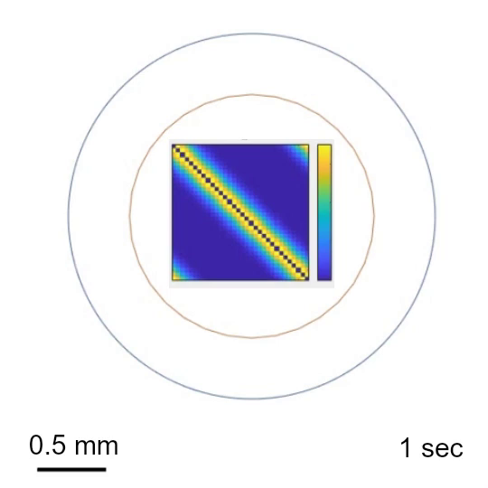

---
# Feel free to add content and custom Front Matter to this file.
# To modify the layout, see https://jekyllrb.com/docs/themes/#overriding-theme-defaults

layout: home
---

<h3> Computational portal for modelling brain cells with stochastic nano-properties and interactive 3D environment.</h3>

<!-- Container for all four tools with videos -->

  <!-- ASTRO -->
  

    

      
<strong><h3>ASTRO</h3></strong> simulates complex realistic astrocytes incorporating their stochastic nanoscopic 
      morphology

    

     
    
    <video id="vidAstro" loop autoplay muted playsinline>
      <source src="assets/Astro.mp4" type="video/mp4">
    </video>
  

  <!-- BRAINCELL -->
  

    

      
<strong><h3>BRAINCELL</h3></strong> simulates brain cell morphology and physiology
      with their stochastic nano-features, dynamic extracellular environment and inter-cellular 

      
 signalling, on the scale from nanometers to hundreds of microns 

    

     
    
    <video id="vidBraincell" loop autoplay muted playsinline>
      <source src="assets/BrainCellGaba.mp4" type="video/mp4">
    </video>
  

  <!-- STOCHASTIC SYNAPSE -->
  

    

      
<strong><h3>STOCHASTIC SYNAPSE</h3></strong> simulates release, Brownian diffusion and uptake of neurotransmitter among nanoscopic obstacles, and computes activation of synaptic and extrasynaptic receptors

    

     
    
    <video id="vidStochastic" loop autoplay muted playsinline>
      <source src="assets/stochasticSynapse.mp4" type="video/mp4">
    </video>
  

  <!-- ARACHNE -->
  

    

      
<strong><h3>ARACHNE</h3></strong> simulates multi-cell spiking neuronal networks with astrocytes, excitation-inhibition, volume transmission, and flexible memory rules 
 
    

    
    <video id="vidArachne" loop autoplay muted playsinline>
      <source src="assets/Arachne.mp4" type="video/mp4">
    </video>
  

